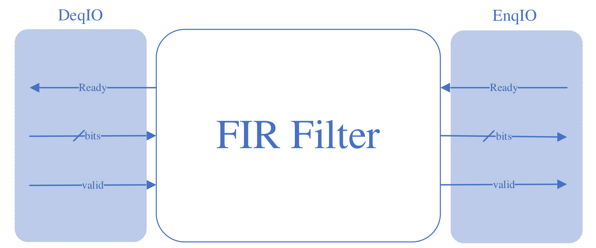
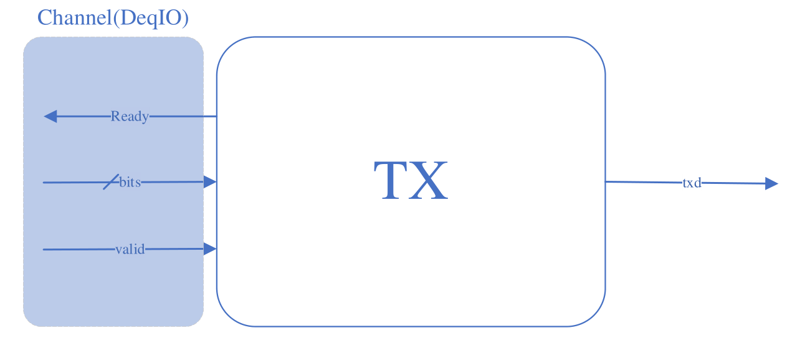
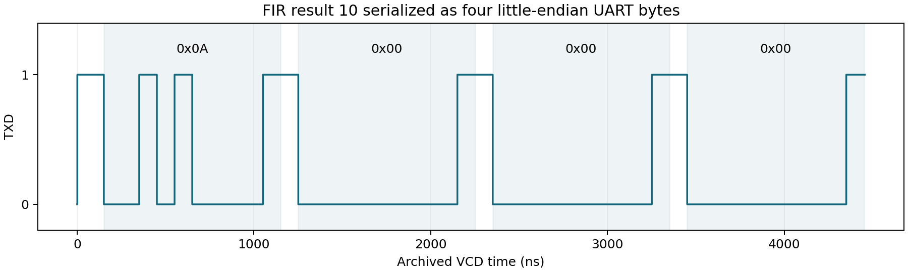

# Sequential FIR Filter with UART Output in Chisel

A signed FIR filter and UART transmitter connected through ready/valid interfaces. The filter reuses a multiply-accumulate datapath across its taps, while the top module converts each 32-bit result into four little-endian serial bytes.

Analysis of the supplied waveforms confirms the recorded examples: **FIR inputs 10, 20, 30 produce 10, 40, 100**, the standalone transmitter sends **0x55**, and the integrated design sends **0A 00 00 00**, reconstructing the value **10**. These are observations from archived simulation data, not newly executed Chisel tests.

## Problem and design progression

The filter produces a 32-bit result faster than a byte-oriented serial interface can transmit it. The design must retain samples and results, serialize the output, and propagate backpressure without overwriting pending data.

| Phase                   | Capability                                                             | Source and verification entry point                    |
| ----------------------- | ---------------------------------------------------------------------- | ------------------------------------------------------ |
| 1. Sequential FIR       | Signed filtering with configurable tap count and ready/valid transfers | `FIR.scala`, `FIRTestApp`                              |
| 2. UART and integration | Buffered serial transmission and four-byte result serialization        | `UART.scala`, `Top.scala`, `UARTTestApp`, `TopTestApp` |

One integrated source snapshot is supplied. The phase descriptions explain implementation scope and progression; they do not imply separate historical releases.

## Phase 1: Sequential FIR



_FIR input and output interfaces extracted from the design specification._

For coefficients `weights`, the filter computes

$$
y[n] = \sum\_{k=0}^{N-1} w[k]x[n-k].
$$

Input samples and coefficients are signed 16-bit values. The accumulator and output are signed 32-bit values. Coefficients and tap count are selected at elaboration through `Seq[Int]`; they are not runtime-programmable registers. The supplied generators and tests use `[1, 2, 3]`.

The FSM accepts a sample in `sIdle`, shifts the sample history, clears the accumulator, and performs one tap operation per cycle in `sCompute`. In `sDone`, it presents the result and holds it until the receiver is ready. History is zero-initialized.

**Phase result.** The recorded transactions match the three supplied expected values:

| Input | Computation          | Observed output | Input transfer (ns) | Output transfer (ns) |
| ----: | -------------------- | --------------: | ------------------: | -------------------: |
|    10 | `1×10 + 2×0 + 3×0`   |              10 |                  61 |                  101 |
|    20 | `1×20 + 2×10 + 3×0`  |              40 |                 111 |                  151 |
|    30 | `1×30 + 2×20 + 3×10` |             100 |                 161 |                  201 |

With three taps, output valid becomes available after three compute edges; the earliest output transfer is four clock periods after input acceptance. The next input can be accepted five periods after the previous one when the output is not stalled. The archived FIR clock spacing is 10 ns. These figures describe cycle sequencing, not a measured hardware maximum frequency.

The 32-bit accumulator has no saturation or overflow flag. Long filters and large coefficients can overflow. Negative samples, overflow boundaries, output stalls and other tap counts are not covered by the supplied three-vector test.

## Phase 2: UART transmitter and result serialization



_UART transmitter interface from the design specification. The implementation adds a one-byte buffer before the transmitter._

`Tx` sends idle-high, 8N1 frames: one low start bit, eight data bits least-significant-bit first, and a high stop bit. `Buffer` holds one byte between producer and transmitter; `BufferedTx` connects the two.

The baud counter reload value is

$$
\mathrm{BIT_CNT}=\left\lfloor\frac{f\_{clk}+\mathrm{baud}/2}{\mathrm{baud}}\right\rfloor-1.
$$

| Configuration               | Parameters                              | Clocks per bit |
| --------------------------- | --------------------------------------- | -------------: |
| Supplied UART and Top tests | `frequency=10000`, `baudRate=1000`      |             10 |
| Supplied RTL generators     | `frequency=50000000`, `baudRate=115200` |            434 |

For a physical 50 MHz clock, 434 clocks per bit would produce approximately 115,207.37 baud. This is a divider calculation, not a board measurement. The recorded tests use 10 ns simulation clock periods and 100 ns bit cells; the constructor's `frequency` parameter does not set the simulator clock.

**Progress over Phase 1.** `Top` captures the FIR result in a 32-bit register, offers bits 7:0 to the UART buffer, and shifts right by eight only when that byte is accepted. Four accepted bytes complete the serializer's work. A negative result is transmitted as its 32-bit two's-complement bit pattern.

Backpressure reaches the FIR output while the serializer is busy. The filter can still accept and compute a subsequent sample after its preceding result is consumed, then wait with that next result. Completion of the fourth byte handshake means it has been queued, not that its stop bit has already left TXD. The supplied integrated test exercises only one input result, so sustained multi-result behavior is not established by that capture.

## Recorded UART and integrated results



_TXD from the supplied Top waveform. Shaded regions show the four decoded 8N1 frames._

| Capture    | Observed data       | Frame start times (ns)   | Last VCD timestamp (ns) |
| ---------- | ------------------- | ------------------------ | ----------------------: |
| FIR        | Outputs 10, 40, 100 | Not applicable           |                     206 |
| BufferedTx | `55`                | 151                      |                   1,156 |
| Top        | `0A 00 00 00`       | 151, 1,251, 2,351, 3,451 |                   4,456 |

All decoded frames have the expected sampled start and stop levels. The four Top bytes reconstruct `0x0000000A = 10`. The 1,100 ns spacing between their start bits equals 11 bit periods: this transmitter introduces an additional idle-high bit period beyond the ten-bit frame before accepting the next byte at a baud tick.

The original [waveform directories](results/archive/test_run_dir), extracted [FIR transactions](results/fir-transfers.csv), [UART frames](results/uart-frames.csv), and [analysis summary](results/vcd-analysis.json) are retained. The source tests contain expected-value or framing checks, but no saved console verdict or test-result XML was found. The published result is independently extracted from their archived waveforms.

## Generated hardware artifacts

The archive contains Scala-backend Verilog/FIRRTL and a separate CIRCT SystemVerilog tree. The CIRCT output identifies **firtool-1.146.0**. The accompanying conversion command is preserved in [original-firtool-command.txt](docs/original-firtool-command.txt).

| Location under `results/archive/`               | Content                                                    |
| ----------------------------------------------- | ---------------------------------------------------------- |
| `FIRRTL/FIR/`                                   | FIR intermediate forms                                     |
| `Verilog/FIR/`, `Verilog/UART/`, `Verilog/Top/` | Legacy generated RTL and intermediate files                |
| `Verilog/CIRCT_firtool/`                        | FIRRTL inputs and split SystemVerilog outputs              |
| `test_run_dir/`                                 | Three VCD captures and their associated intermediate files |

The generated UART reload value is 433, consistent with the 50 MHz / 115200 generator settings. The test configurations use a reload value of 9. These artifacts therefore represent different parameterizations. No equivalence proof, synthesis result, area measurement or physical timing result is included, and the generated RTL was not resimulated during preparation.

## Build and run

The original build configuration is preserved: sbt **1.5.3**, Scala **2.12.12**, Chisel **3.4.2**, chisel-iotesters **1.5.1**, and chiseltest **0.3.1**. The supplied setup material specifies JDK 11. IntelliJ IDEA can import `build.sbt`; committed IDE metadata is unnecessary.

Run from the repository root:

```sh
sbt compile 'Test / compile'
sbt 'Test / runMain FIRTestApp'
sbt 'Test / runMain UARTTestApp'
sbt 'Test / runMain TopTestApp'
```

These tests are executable `App` objects using `PeekPokeTester`. Do not assume `sbt test` discovers them as test suites. Their driver return values are not explicitly converted into process exit failures, and several waiting loops have no timeout; inspect simulator diagnostics as well as command exit status.

Generate fresh artifacts with the existing entry points:

```sh
sbt 'runMain FIRFirrtl'
sbt 'runMain FIRVerilog'
sbt 'runMain BufferedTxMaker'
sbt 'runMain TopMaker'
```

For the separate conversion route, using the supplied CIRCT input:

```sh
firtool results/archive/Verilog/CIRCT_firtool/UART/BufferedTx.fir -O=release --strip-debug-info --split-verilog --disable-all-randomization -o generated/circt-uart
```

The bundled command originally assumes `BufferedTx.fir` is in the current directory. The command above uses the preserved CIRCT input, which includes a `FIRRTL version 2.0.0` declaration absent from the legacy generator output. The archived pairs differ by that declaration. Fresh legacy output needs a compatible conversion workflow; do not assume adding a version header alone validates arbitrary FIRRTL. This conversion command was not rerun here.

To reproduce the waveform analysis without hardware tools:

```sh
python3 scripts/analyze_archive.py
# Optional plot regeneration, with matplotlib installed:
python3 scripts/plot_archive.py
```

The analyzer checks existing VCD data only. Neither sbt nor firtool was available in the preparation environment, so no new Scala or HDL execution is claimed.

## Repository structure

| Path                                    | Purpose                                            |
| --------------------------------------- | -------------------------------------------------- |
| `src/main/scala/`                       | FIR, UART and Top implementations                  |
| `src/test/scala/`                       | Original three directed tests                      |
| `build.sbt`, `project/build.properties` | Unchanged build and dependency settings            |
| `results/archive/`                      | Original simulation and generation artifacts       |
| `results/`                              | Extracted measurements and source hashes           |
| `scripts/`                              | Archived-waveform analysis and plotting            |
| `docs/figures/`                         | Extracted interface diagrams and measured TXD plot |
| `docs/technical-review.md`              | Timing, buffering and verification boundaries      |

All Scala and build files are preserved byte for byte. IDE files and build caches are excluded. [Technical review](docs/technical-review.md) document the supporting evidence and remaining verification work.
